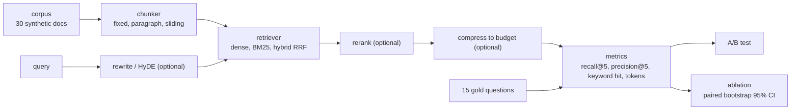

# Jagadish-rag-optimization

[](https://github.com/jagadishmazure-jpg/Jagadish-rag-optimization/actions/workflows/ci.yml)
[](https://github.com/jagadishmazure-jpg/Jagadish-rag-optimization/actions/workflows/codeql.yml)


**A RAG tuning harness: swap chunking, retrieval, reranking, query rewriting and compression one at a time, measure recall, precision, keyword hits and tokens on a gold set, and report each change with a bootstrap interval so small-sample noise is visible.**

> Personal learning and portfolio project. Everything runs offline on synthetic,
> fictional data with no API keys. Nothing is deployed. Numbers in this README
> come from real runs and are re-checked by CI (`scripts/render_docs.py --check`).

## Recruiter summary

- Composable pipeline (chunker, retriever, reranker, compressor) with an A/B test and a one-change-at-a-time ablation over 10 variants.
- Real run on 30 synthetic documents and 15 gold questions: hybrid plus rerank lifts recall@5 from 0.633 to 0.933; BM25 alone reaches 1.000; HyDE, query rewrite and chunking changes have intervals that include zero.
- Found and fixed a bug in my own harness: the A/B test scored retrieval before reranking, so the reranker was never measured.

## Purpose

RAG advice is usually a list of techniques. What I wanted to practise is the
measurement: change one thing, compare on a gold set, and say whether the
difference is bigger than the noise. The corpus and embeddings are synthetic
so the run is offline and repeatable; the point is the harness, not the
absolute numbers.

## Architecture



## How it works

**Pipeline** (`ragopt/pipeline.py`): `RAGPipeline` chains a chunker, a
retriever and optional reranker and compressor; `ranked()` returns the final
ordering that the metrics score.

**Components** (`ragopt/chunking.py`, `retrieve.py`, `rerank.py`,
`rewrite.py`, `compress.py`, `embeddings.py`): three chunkers; dense, BM25 and
reciprocal-rank-fusion hybrid retrievers; a simulated cross-encoder reranker;
synonym rewrite and HyDE; a token-budget compressor; hash embeddings with a
cache.

**Evaluation** (`ragopt/eval.py`, `ragopt/ablation.py`): recall@5,
precision@5, keyword hit rate and average tokens; `ABTest` compares two
pipelines; the ablation changes one component from the baseline per row and
reports a paired bootstrap interval (2,000 resamples, seed 7) for the recall
change. Guide: [docs/optimization-guide.md](docs/optimization-guide.md).

## Real code and output

```python
"""A/B test, then a one-change-at-a-time ablation with bootstrap intervals.

Synthetic corpus (fictional company), fake hash embeddings and a simulated
cross-encoder: results show what the harness measures, not what a real
embedding model would score. 15 gold questions only.
"""
from ragopt import (
    ABTest,
    BM25Retriever,
    CachedEmbeddings,
    ContextCompressor,
    DenseRetriever,
    FakeEmbeddings,
    FixedChunker,
    HybridRetriever,
    RAGPipeline,
    Reranker,
    build_corpus,
    build_gold_questions,
)
from ragopt.ablation import markdown, run_ablation

docs, gold = build_corpus(), build_gold_questions()
print(f"{len(docs)} synthetic docs, {len(gold)} gold questions\n")
chunks = []
for d in docs:
    chunks += FixedChunker(200, 50).chunk(d.doc_id, d.text)
emb = CachedEmbeddings(FakeEmbeddings())
dense = DenseRetriever(chunks, emb)
hybrid = HybridRetriever(dense, BM25Retriever(chunks))
base = RAGPipeline("baseline", FixedChunker(200, 50), dense)
opt = RAGPipeline("hybrid+rerank", FixedChunker(200, 50), hybrid,
                  reranker=Reranker(hybrid, top_n=20, top_k=5),
                  compressor=ContextCompressor(token_budget=600))
print(ABTest(gold, k=5).run(base, opt).summary())
print("\nAblation (one change from the baseline):")
print(markdown(run_ablation(docs, gold), len(gold)))
```

Output of `python examples/demo.py` (real run, re-checked in CI):

<!-- run: python examples/demo.py -->
```text
30 synthetic docs, 15 gold questions

A/B: baseline vs hybrid+rerank
  recall@5: A=0.633 B=0.933 delta=+0.300
  precision@5: A=0.173 B=0.293 delta=+0.120
  keyword_hit_rate: A=0.233 B=0.833 delta=+0.600
  avg_tokens: A=190.067 B=211.133 delta=+21.067
  winner: hybrid+rerank (margin +0.300)

Ablation (one change from the baseline):
| Variant (one change from baseline) | recall@5 | delta | 95% CI of delta | keyword hit | avg tokens |
|---|---:|---:|---|---:|---:|
| baseline (fixed 200/50 + dense) | 0.633 | +0.000 | [+0.000, +0.000] | 0.233 | 190.1 |
| chunking: paragraph | 0.733 | +0.100 | [-0.133, +0.333] (includes 0) | 0.267 | 332.9 |
| chunking: sliding 60/15 | 0.733 | +0.100 | [-0.133, +0.333] (includes 0) | 0.267 | 329.3 |
| retrieval: BM25 only | 1.000 | +0.367 | [+0.167, +0.600] | 0.900 | 207.5 |
| retrieval: hybrid (RRF) | 0.867 | +0.233 | [+0.067, +0.467] | 0.500 | 209.3 |
| rerank on dense | 0.933 | +0.300 | [+0.067, +0.533] | 0.833 | 213.2 |
| query rewrite (synonyms) | 0.633 | +0.000 | [+0.000, +0.000] | 0.233 | 189.1 |
| HyDE | 0.667 | +0.033 | [-0.233, +0.300] (includes 0) | 0.333 | 213.5 |
| compression (600-token budget) | 0.633 | +0.000 | [+0.000, +0.000] | 0.233 | 190.1 |
| all: hybrid + rerank + compression | 0.933 | +0.300 | [+0.067, +0.533] | 0.833 | 211.1 |

15 gold questions; intervals are paired bootstrap (2,000 resamples, seed 7).
```
<!-- /run -->

## How to run

```bash
git clone https://github.com/jagadishmazure-jpg/Jagadish-rag-optimization.git
cd Jagadish-rag-optimization
python -m pip install pytest      # no runtime dependencies
python -m pytest -q          # offline, no keys
python examples/demo.py
python scripts/render_docs.py --check   # documented output still matches
```

Test suite size (real collection, re-checked in CI):

<!-- run: python scripts/count_tests.py -->
```text
39 tests collected
```
<!-- /run -->

## Guardrails

- One change at a time from a fixed baseline, so each row isolates a technique.
- Every delta has a 95% interval; rows whose interval includes zero are marked.
- Token cost is reported next to quality, so a gain that doubles context is visible.

## Limitations

- 15 gold questions is a small sample; most intervals are wide, and three changes cannot be told apart from zero.
- "Dense" embeddings are hashed bags of words, so lexical methods are favoured; with a real embedding model the ranking of variants may change.
- The reranker is simulated with term-coverage features, not a cross-encoder model.
- Synthetic corpus written for this repo; real documents are messier.

## Built vs planned

| Capability | Status | Where |
|---|---|---|
| Composable pipeline and components | Built | `ragopt/` |
| A/B test on the final ranking | Built | `ragopt/eval.py` |
| Ablation with paired bootstrap intervals | Built | `ragopt/ablation.py` |
| Real embeddings and cross-encoder | Planned | docs/implementation-guide.md |
| Larger gold set from real queries | Planned | not started |

## Threat model

| Threat | Mitigation in this repo | Status |
|---|---|---|
| Shipping a change that only looked better by chance | Bootstrap interval per change | Built |
| Measuring the wrong stage | Metrics on the final ranking | Built |
| Prompt injection inside retrieved documents | Not handled here; see agent-security repo | Planned |

## Interview points

- My harness had a bug: it measured retrieval before rerank, so the reranker always looked useless.
- BM25 alone won here because the embeddings are lexical; I say that instead of claiming hybrid always wins.
- With 15 questions, a +0.10 change can be noise; the bootstrap interval shows it.

More, with likely follow-up questions: [docs/interview-points.md](docs/interview-points.md).

## Implementation guide

The step-by-step path from this offline build to an Azure deployment is in
[docs/implementation-guide.md](docs/implementation-guide.md). None of it has been
run; it is a plan.

## Related repositories

| Repo | How it relates |
|---|---|
| [Jagadish-agentic-rag](https://github.com/jagadishmazure-jpg/Jagadish-agentic-rag) | GraphRAG and self-correcting retrieval |
| [Jagadish-llm-evals-observability](https://github.com/jagadishmazure-jpg/Jagadish-llm-evals-observability) | Generation-side evals and tracing |
| [Jagadish-document-intelligence](https://github.com/jagadishmazure-jpg/Jagadish-document-intelligence) | Getting clean text out of documents first |
| [Jagadish-text2sql-data-agent](https://github.com/jagadishmazure-jpg/Jagadish-text2sql-data-agent) | When the answer is in a table, not a document |

## Documentation

- [Optimisation guide](docs/optimization-guide.md)
- [Implementation guide (Azure)](docs/implementation-guide.md)
- [Interview points](docs/interview-points.md)
- [Security policy](SECURITY.md)

## Project layout

```
ragopt/
  corpus.py      30 synthetic docs + 15 gold questions
  chunking.py    fixed, paragraph, sliding window
  embeddings.py  hash embeddings + cache
  retrieve.py    dense, BM25, hybrid (RRF)
  rerank.py      two-stage rerank
  rewrite.py     synonyms, HyDE
  compress.py    token budget
  pipeline.py    RAGPipeline, ranked()
  eval.py        metrics, ABTest
  ablation.py    one-change ablation, bootstrap CI
examples/demo.py the run shown above
tests/           offline pytest suite
```

## License

MIT, see [LICENSE](LICENSE). All data is synthetic; every organisation and person is fictional.
